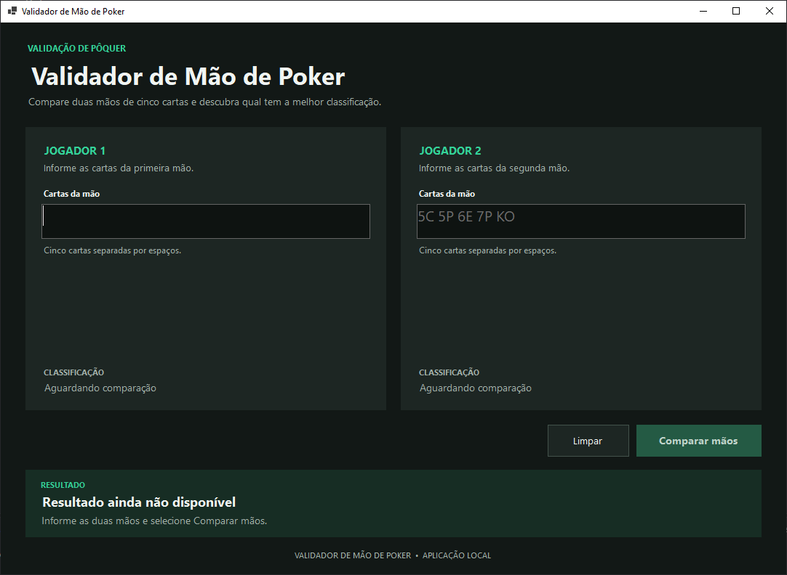
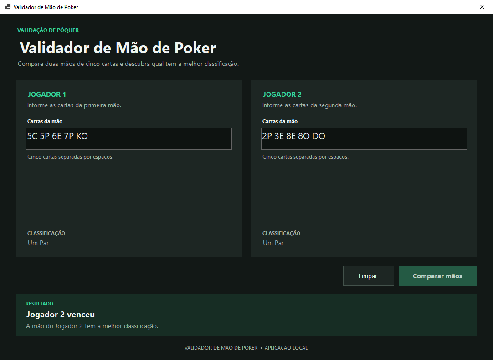
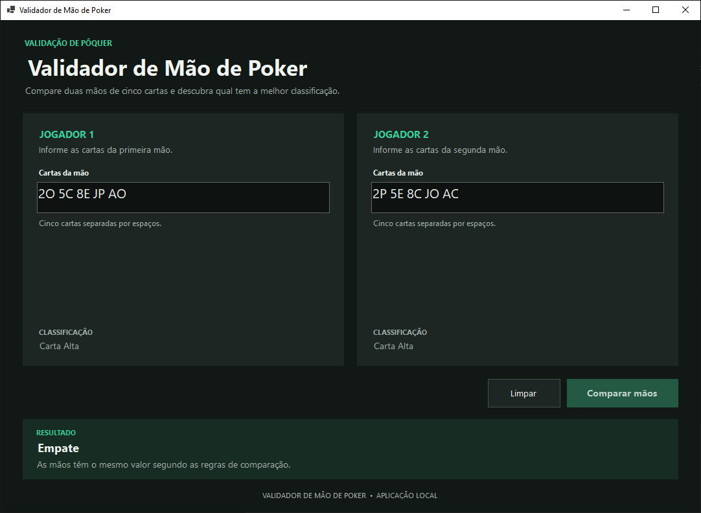
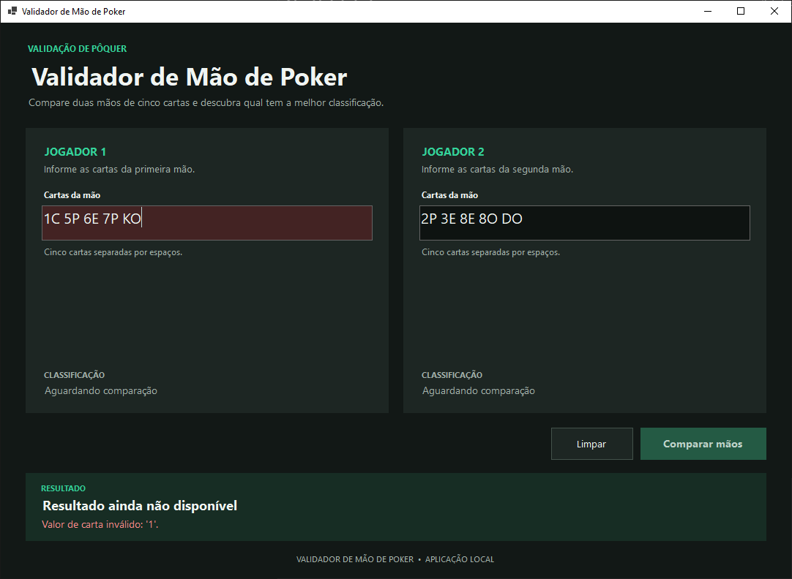

<div align="center">

<a id="inicio"></a>

# ♠️ Validador de Mão de Poker

**Aplicação desktop em C# para validar, classificar e comparar duas mãos de Poker.**


**Projeto acadêmico • Academia do Programador**

</div>

---

## 📖 Sobre o projeto

O **Validador de Mão de Poker** recebe duas mãos com cinco cartas cada, identifica a classificação de cada uma e determina o vencedor ou um empate, seguindo as regras adotadas no exercício.

A solução separa as **regras de negócio** da **interface gráfica** e conta com testes automatizados. A aplicação roda localmente no Windows, sem necessidade de banco de dados ou serviços externos.

### ✨ Funcionalidades

- Validação do formato das cartas, quantidade de cartas e cartas duplicadas.
- Rejeição de cartas físicas compartilhadas entre os dois jogadores.
- Classificação das dez categorias de mãos implementadas.
- Comparação por categoria e, quando necessário, por valores das cartas.
- Exibição do vencedor ou empate, com mensagens em português.
- Destaque visual de entradas inválidas e botão para limpar a comparação.
- Interface gráfica em Windows Forms com tema escuro.

## 🖼️ Interface da aplicação

<details>
<summary><strong>📸 Ver capturas da aplicação</strong></summary>

### Tela inicial


### Comparação com vencedor


### Empate


### Validação de entrada


</details>

## 🃏 Como informar as cartas

Cada carta é representada por **dois caracteres**: o primeiro identifica o valor e o segundo, o naipe.

| Elemento | Códigos | Significado |
|---|---|---|
| Valor | `2` a `9` | Cartas numéricas |
| Valor | `D` | Dez |
| Valor | `J` | Valete |
| Valor | `Q` | Dama |
| Valor | `K` | Rei |
| Valor | `A` | Ás |
| Naipe | `O` | Ouros ♦ |
| Naipe | `C` | Copas ♥ |
| Naipe | `E` | Espadas ♠ |
| Naipe | `P` | Paus ♣ |

Digite **cinco cartas separadas por espaços**, por exemplo:

```text
Jogador 1: 5C 5P 6E 7P KO
Jogador 2: 2P 3E 8E 8O DO
```

Nesse exemplo, os dois jogadores têm **Um Par**, mas o **Jogador 2 vence** porque seu par de oitos supera o par de cincos.

## 🏆 Classificações implementadas

Da mais forte para a mais fraca:

| Posição | Classificação | Descrição resumida |
|:---:|---|---|
| 1 | Royal Flush | Dez, Valete, Dama, Rei e Ás do mesmo naipe |
| 2 | Straight Flush | Cinco valores consecutivos do mesmo naipe |
| 3 | Quadra | Quatro cartas do mesmo valor |
| 4 | Full House | Uma trinca e um par |
| 5 | Flush | Cinco cartas do mesmo naipe |
| 6 | Sequência | Cinco valores consecutivos |
| 7 | Trinca | Três cartas do mesmo valor |
| 8 | Dois Pares | Dois pares de valores diferentes |
| 9 | Um Par | Duas cartas do mesmo valor |
| 10 | Carta Alta | Nenhuma das combinações anteriores |

**Regras e decisões do exercício:**

- O Ás tem valor **14**; a sequência `A-2-3-4-5` não é reconhecida como sequência.
- Os **naipes não são usados para desempatar**.
- Mãos da mesma categoria são comparadas pelos valores relevantes e pelas cartas restantes, quando aplicável.
- Não é permitido reutilizar a mesma carta física entre os jogadores.

## 🏗️ Arquitetura

```text
ValidarMaoDePoker/
├── src/
│   ├── ValidarMaoDePoker.Domain/
│   │   ├── Carta.cs
│   │   ├── MaoPoker.cs
│   │   ├── ClassificadorMaoPoker.cs
│   │   ├── ComparadorMaoPoker.cs
│   │   └── ...
│   └── ValidarMaoDePoker.WinForms/
│       ├── FormPrincipal.cs
│       ├── FormPrincipal.Designer.cs
│       └── Program.cs
├── tests/
│   └── ValidarMaoDePoker.Tests/
├── docs/
│   └── images/                  # Capturas opcionais da interface
├── ValidarMaoDePoker.slnx
├── .gitignore
└── README.md
```

| Projeto | Responsabilidade |
|---|---|
| **Domain** | Modelagem de cartas e mãos, validação, classificação, comparação e desempates |
| **WinForms** | Entrada das mãos e apresentação dos resultados e mensagens de validação |
| **Tests** | Verificação automatizada das regras de domínio com MSTest |

O projeto WinForms e o projeto de testes referenciam o **Domain**. As regras de Poker não são duplicadas na interface.

## 🛠️ Tecnologias

- **C# / .NET 10** — linguagem e plataforma.
- **Windows Forms** — interface gráfica nativa para Windows.
- **MSTest 4.0.1** — testes automatizados.
- **Visual Studio Code** — ambiente utilizado no desenvolvimento.

## ▶️ Como executar

**Pré-requisitos:** Windows e **.NET SDK 10** instalado.

1. Clone o repositório:

   ```powershell
   git clone https://github.com/GustavoTessaro/ValidarMaoDePoker.git
   cd ValidarMaoDePoker
   ```

2. Restaure as dependências e compile:

   ```powershell
   dotnet restore ValidarMaoDePoker.slnx
   dotnet build ValidarMaoDePoker.slnx
   ```

3. Inicie a aplicação:

   ```powershell
   dotnet run --project src/ValidarMaoDePoker.WinForms/ValidarMaoDePoker.WinForms.csproj
   ```

Na janela, preencha as duas mãos e clique em **Comparar mãos**. Para iniciar outra comparação, use **Limpar**.

## 🧪 Testes automatizados

Execute na raiz do repositório:

```powershell
dotnet test ValidarMaoDePoker.slnx
```

**Última validação informada na auditoria do projeto:**

| Indicador | Resultado |
|---|---|
| Testes aprovados | **125** |
| Testes com falha | **0** |
| Testes ignorados | **0** |
| Erros de compilação | **0** |
| Avisos de compilação | **0** |

A suíte cobre validação de cartas e mãos, classificações, desempates, entradas inválidas, duplicidade de cartas e casos-limite.

## 📌 Observações

O projeto foi desenvolvido para executar **localmente no Windows**. Não utiliza Azure, banco de dados ou serviços de rede e não requer instalador para ser executado a partir do código-fonte com o SDK.

Durante os testes, foram identificadas inconsistências em dois exemplos do enunciado original, incluindo reutilização de cartas físicas entre jogadores. Os testes documentam adaptações que preservam a intenção das comparações sem aceitar cartas repetidas.

---

## 👨‍💻 Autor

**Gustavo Tessaro**

[](https://github.com/GustavoTessaro)

---

<div align="center">

## ⭐ Se este projeto foi útil para você, considere deixar uma estrela no repositório!

[⬆ Voltar ao início](#inicio)

</div>
